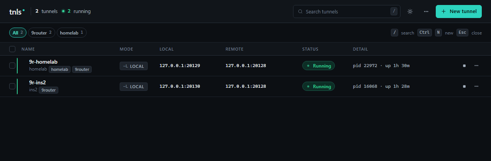

**English** · [Tiếng Việt](README.vi.md)

# tnls — SSH tunnel manager

tnls is a lightweight desktop app for SSH tunnels. You save each tunnel as a
profile and start or stop it from a table instead of keeping one terminal
window open per `ssh -L` command; the app keeps running in the system tray. It
is built with Tauri 2, React and Rust, and drives the OpenSSH client already
installed on your machine, so your `~/.ssh/config`, keys and ssh-agent work as
they do in a terminal. There is no server and no cloud account: profiles live
in a local SQLite file.



## Features

- **Profiles**: create, edit, duplicate and delete tunnels, stored in SQLite.
  A live preview in the form shows the exact `ssh` command that will run.
- **Forwarding modes**: local (`-L`), remote (`-R`) and dynamic SOCKS (`-D`),
  with an optional identity file, ProxyJump (`-J`), and `~/.ssh/config`
  aliases as the SSH target.
- **Safe defaults**: ssh runs from an argument list (never through a shell)
  with `BatchMode=yes`, `ExitOnForwardFailure=yes` and keepalive; the bind
  address defaults to `127.0.0.1`.
- **Health check**: for `-L` and `-D`, tnls dials the local endpoint and marks
  a tunnel Degraded when the process is alive but the port does not accept
  connections. A starting tunnel gets up to 20 s to open its port.
- **Retry policy**: per-tunnel max retries (0–20) and base delay (1–30 s,
  doubling, capped at 30 s). Only transient failures are retried (server
  unreachable, or ssh exiting for an unrecognized reason); config errors such
  as auth failure, host-key mismatch or a taken port fail at once.
- **Port-conflict detection**: before a start, tnls checks whether the local
  port is held by another tnls tunnel or by another process, names the holder
  (process name and PID where the OS reports them), and offers to stop the
  other tunnel or change the port.
- **Connection diagnostics**: a read-only check in three stages (SSH
  auth/reachability, local port, destination as seen from the server) that
  stops at the first failure and reports the reason, e.g. auth failed,
  connection refused, timeout or DNS failure.
- **Tags**: group tunnels with tags, filter the list by tag, and start, stop or
  delete a whole group.
- **Search and bulk actions**: search by name, host, port or tag; select rows
  to start, stop, restart or delete them together.
- **Logs**: per-tunnel log viewer with timestamps and levels (ssh stderr plus
  tnls lifecycle events), filters and follow mode. Logs are kept in memory
  only and cleared when tnls quits.
- **Import / export**: copy all profiles as JSON, import JSON, and import
  `Host` entries with `LocalForward` from `~/.ssh/config`.
- **Auto-start**: start selected tunnels when tnls launches, and optionally
  start tnls on login.
- **Tray**: Show, Start all, Stop all and Quit. The window close button asks
  whether to minimize to the tray or quit (the choice can be remembered).
  Quitting always stops every tunnel.
- **Notifications**: desktop notifications when a tunnel fails, schedules a
  retry, degrades or recovers.
- Light and dark themes.

### Known limitations

- A key passphrase can be saved to the OS keychain from the form, but it is
  **not passed to ssh yet** (ssh runs with `BatchMode=yes`). Use ssh-agent for
  keys that have a passphrase.
- Password authentication is not supported, for the same reason.
- Only Windows builds have been tested. CI compiles and tests the Rust code on
  Windows, macOS and Linux, but no macOS or Linux package has been tried.

## Install

Installers will be attached to
[GitHub Releases](https://github.com/khanhnv219/tnls/releases) once a version
is published (see [Release](#release)); none is published yet. Until then,
build tnls yourself (see [Build](#build)). The Windows build produces two
installers in `src-tauri/target/release/bundle/`:

- `nsis/tnls_<version>_x64-setup.exe`
- `msi/tnls_<version>_x64_en-US.msi`

tnls needs an OpenSSH client (`ssh` or `ssh.exe`) on `PATH`. Current Windows 10
and 11 releases ship it as the "OpenSSH Client" optional feature.

Profiles are stored in `tunnels.db` in the app data directory
(`%APPDATA%\com.tnls.app\` on Windows). Version 0.2.0 migrates the database to
schema v4; older versions cannot open it afterwards, so back the file up before
upgrading.

## Usage

1. Click **New tunnel** (or press `Ctrl+N`). Enter a name, pick a mode, the SSH
   target (`user@host` or a `~/.ssh/config` alias), the local port, and for
   `-L`/`-R` the remote host and port. Save.
2. Press the **▶** button on the row to start it; the status goes Starting →
   Running. Press **■** to stop. The **⋯** menu has restart, edit, duplicate,
   logs and *Diagnose connection*.
3. If a start fails, open **View logs** or **Diagnose connection** to see which
   stage failed and why.
4. Close the window and choose **Minimize to tray** to keep tunnels running;
   click the tray icon to bring the window back. Use **Quit** in the tray menu
   to stop everything and exit.
5. To bring tunnels up automatically, turn on **Auto-start with app** in the
   tunnel's Advanced section, and **Start tnls on login** in the **⋯** menu.

## Develop

Prerequisites: Node.js 24, Rust (stable), an OpenSSH client, and the
[Tauri 2 prerequisites](https://v2.tauri.app/start/prerequisites/) for your
OS (MSVC Build Tools and WebView2 on Windows; `libwebkit2gtk-4.1-dev`,
`libappindicator3-dev`, `librsvg2-dev` on Debian/Ubuntu).

```bash
npm install
npm run tauri dev   # desktop app with hot reload
npm run dev         # frontend only, in a browser; backend calls fail without Tauri
```

## Build

```bash
npm run build         # typecheck + frontend bundle
npm run tauri build   # release app + installers (MSVC Build Tools needed on Windows)
```

## Test

```bash
cd src-tauri
cargo test -p tnls-core                          # unit tests (domain, persistence, ssh, manager, ports, diagnostics)
cargo test -p tnls-core real_ssh -- --ignored    # optional: runs the system ssh, no SSH server needed
cargo clippy --workspace --all-targets -- -D warnings
cargo fmt -- --check
cd ..
npx tsc --noEmit
```

The [`test`](.github/workflows/test.yml) workflow runs the same checks (fmt,
core tests, clippy, `cargo check` on Windows, macOS and Ubuntu, plus the
frontend typecheck and build). It only runs when started by hand from the
Actions tab; pushes and pull requests do not trigger it, so run the commands
above locally before you push.

## Release

Pushing a tag `v<version>` that matches `version` in
`src-tauri/tauri.conf.json` runs the [`release`](.github/workflows/release.yml)
workflow. It builds installers for Windows, macOS (Apple Silicon and Intel) and
Linux and publishes them as a GitHub Release. It does not run tests, so run the
`test` workflow or the local checks first.

```bash
git tag v0.2.0
git push origin v0.2.0
```

## Architecture

```text
React UI (src/)                    tables, forms, drawers, dialogs
  → Tauri commands (src-tauri/src) IPC: CRUD, start/stop, logs, diagnostics, events
    → TunnelManager (tnls-core)    one Rust supervisor: lifecycle, health, retries, port checks
      → OpenSSH process            ssh -N … spawned from an argv list, stderr captured
  → SQLite (tunnels.db)            typed profiles; never raw shell commands
```

Design decisions and the data model are in [`docs/DESIGN.md`](docs/DESIGN.md);
the UI design system is in [`docs/DESIGN_SYSTEM.md`](docs/DESIGN_SYSTEM.md).

## Comparison

| | tnls | Termix | EluGate Conduit | Core Tunnel |
|---|---|---|---|---|
| Platform | Windows (tested); macOS/Linux build from source, untested | Web (self-hosted), Windows, macOS, Linux, iOS, Android | not verified | macOS |
| Tunnel types | `-L`, `-R`, `-D`, ProxyJump | SSH port forwarding with auto-reconnect, plus WireGuard gateways | not verified | local, remote, dynamic, ProxyJump |
| Server required? | No | Self-hosted server (Docker) for the web app | not verified | No |
| Price | Free, open source (MIT) | Free, open source (Apache 2.0) | not verified | Free for 1 host; Premium from US$9.99/year |
| Best for | A desktop list of tunnels on top of the OpenSSH you already use | An all-in-one self-hosted server hub (terminal, SFTP, remote desktop, tunnels) | not verified | Mac users who want a menu-bar tunnel manager with Keychain, tags and sync |

Sources: [Termix README](https://github.com/Termix-SSH/Termix),
[Core Tunnel](https://codinn.com/tunnel/) and its
[App Store page](https://apps.apple.com/au/app/core-tunnel/id1354318707),
checked November 2026. No public information was found for a product named
"EluGate Conduit", so its row is left unverified rather than guessed.

## Contributing

Issues and pull requests are welcome. Before opening a PR, run the commands in
[Test](#test); they are the same gates CI runs. Keep each commit to one change,
and update [`docs/DESIGN.md`](docs/DESIGN.md) when you change a design decision.

## License

[MIT](LICENSE) © 2026 Van Khanh Nguyen
