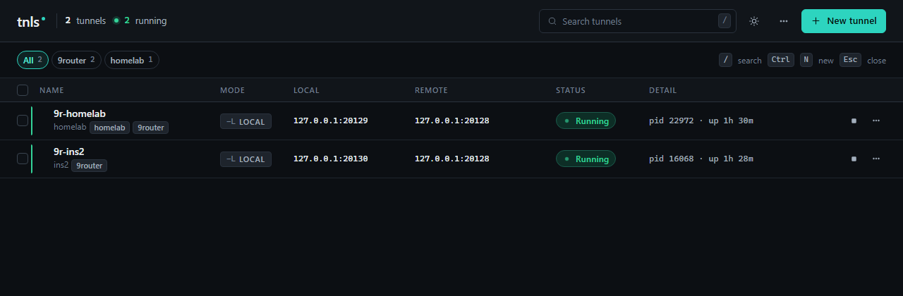

[English](README.md) · **Tiếng Việt**

# tnls — quản lý SSH tunnel

tnls là ứng dụng desktop nhẹ để quản lý SSH tunnel. Mỗi tunnel được lưu thành
một profile và bật/tắt ngay trên bảng, thay vì phải mở một cửa sổ terminal cho
mỗi lệnh `ssh -L`; app tiếp tục chạy dưới system tray. App viết bằng Tauri 2,
React và Rust, và dùng OpenSSH client có sẵn trên máy, nên `~/.ssh/config`, key
và ssh-agent hoạt động giống như trong terminal. Không cần server, không cần tài
khoản cloud: profile nằm trong một file SQLite trên máy.



## Tính năng

- **Profile**: tạo, sửa, nhân bản (duplicate) và xoá tunnel, lưu trong SQLite.
  Form có ô xem trước đúng lệnh `ssh` sẽ được chạy.
- **Kiểu forward**: local (`-L`), remote (`-R`) và dynamic SOCKS (`-D`), có thể
  kèm identity file, ProxyJump (`-J`), và dùng alias trong `~/.ssh/config` làm
  SSH target.
- **Mặc định an toàn**: ssh được chạy từ danh sách tham số (không qua shell)
  với `BatchMode=yes`, `ExitOnForwardFailure=yes` và keepalive; bind address
  mặc định là `127.0.0.1`.
- **Health check**: với `-L` và `-D`, tnls kết nối thử vào endpoint local và
  đánh dấu tunnel là Degraded khi process còn sống nhưng port không nhận kết
  nối. Tunnel đang khởi động có tối đa 20 giây để mở port.
- **Chính sách retry**: số lần retry tối đa (0–20) và độ trễ ban đầu (1–30
  giây, nhân đôi mỗi lần, tối đa 30 giây) cho từng tunnel. Chỉ retry lỗi tạm
  thời (không tới được server, hoặc ssh thoát vì lý do không xác định); lỗi
  cấu hình như sai xác thực, host key không khớp hay port đã bị chiếm thì
  dừng ngay.
- **Phát hiện trùng port**: trước khi start, tnls kiểm tra port local có đang bị
  một tunnel tnls khác hoặc một process khác giữ không, nêu tên bên đang giữ
  (tên process và PID nếu hệ điều hành cho biết), và đề nghị dừng tunnel kia
  hoặc đổi port.
- **Chẩn đoán kết nối**: kiểm tra chỉ đọc (read-only) theo 3 bước (xác thực /
  kết nối SSH, port local, đích nhìn từ phía server), dừng ở bước lỗi đầu tiên
  và nêu lý do, ví dụ: sai xác thực, bị từ chối kết nối, timeout, lỗi DNS.
- **Tag**: nhóm tunnel bằng tag, lọc danh sách theo tag, và start, stop hoặc
  xoá cả nhóm.
- **Tìm kiếm và thao tác hàng loạt**: tìm theo tên, host, port hoặc tag; chọn
  nhiều dòng để start, stop, restart hoặc xoá cùng lúc.
- **Log**: xem log từng tunnel kèm thời gian và level (stderr của ssh và các sự
  kiện vòng đời của tnls), có bộ lọc và chế độ follow. Log chỉ nằm trong bộ nhớ
  và mất khi thoát tnls.
- **Import / export**: copy toàn bộ profile ra JSON, import JSON, và import các
  `Host` có `LocalForward` từ `~/.ssh/config`.
- **Tự khởi động**: tự start các tunnel được chọn khi mở tnls, và tuỳ chọn mở
  tnls khi đăng nhập.
- **Tray**: Show, Start all, Stop all và Quit. Nút đóng cửa sổ sẽ hỏi thu nhỏ
  xuống tray hay thoát (có thể nhớ lựa chọn). Thoát luôn dừng mọi tunnel.
- **Thông báo**: thông báo desktop khi tunnel lỗi, lên lịch retry, bị degraded
  hoặc hồi phục.
- Giao diện sáng và tối.

### Giới hạn hiện tại

- Form cho phép lưu passphrase của key vào keychain của hệ điều hành, nhưng
  passphrase đó **chưa được truyền cho ssh** (ssh chạy với `BatchMode=yes`).
  Với key có passphrase, hãy dùng ssh-agent.
- Chưa hỗ trợ xác thực bằng mật khẩu, cùng lý do trên.
- Mới chỉ thử nghiệm bản build trên Windows. CI có compile và chạy test phần
  Rust trên Windows, macOS và Linux, nhưng chưa ai thử gói cài đặt cho macOS
  hay Linux.

## Cài đặt

Bộ cài sẽ được đính kèm ở
[GitHub Releases](https://github.com/khanhnv219/tnls/releases) khi có phiên bản
được publish (xem [Release](#release)); hiện chưa có bản nào. Trước đó, bạn cần
tự build tnls (xem [Build](#build)). Bản build Windows tạo ra hai bộ cài trong
`src-tauri/target/release/bundle/`:

- `nsis/tnls_<version>_x64-setup.exe`
- `msi/tnls_<version>_x64_en-US.msi`

tnls cần OpenSSH client (`ssh` hoặc `ssh.exe`) trong `PATH`. Các bản Windows 10
và 11 hiện nay có sẵn client này dưới dạng optional feature "OpenSSH Client".

Profile được lưu trong `tunnels.db` ở thư mục dữ liệu của app
(`%APPDATA%\com.tnls.app\` trên Windows). Bản 0.2.0 nâng database lên schema
v4; sau đó các bản cũ không mở được nữa, nên hãy sao lưu file này trước khi
nâng cấp.

## Sử dụng

1. Bấm **New tunnel** (hoặc `Ctrl+N`). Nhập tên, chọn kiểu forward, SSH target
   (`user@host` hoặc alias trong `~/.ssh/config`), port local, và với `-L`/`-R`
   thì nhập thêm remote host và port. Lưu lại.
2. Bấm nút **▶** trên dòng đó để start; trạng thái chuyển Starting → Running.
   Bấm **■** để dừng. Menu **⋯** có restart, edit, duplicate, logs và
   *Diagnose connection*.
3. Nếu start lỗi, mở **View logs** hoặc **Diagnose connection** để xem lỗi ở
   bước nào và vì sao.
4. Đóng cửa sổ và chọn **Minimize to tray** để tunnel tiếp tục chạy; bấm vào
   tray icon để mở lại cửa sổ. Dùng **Quit** trong menu tray để dừng hết và
   thoát.
5. Để tunnel tự chạy, bật **Auto-start with app** trong phần Advanced của
   tunnel, và bật **Start tnls on login** trong menu **⋯**.

## Phát triển

Cần có: Node.js 24, Rust (stable), OpenSSH client, và các
[yêu cầu của Tauri 2](https://v2.tauri.app/start/prerequisites/) cho hệ điều
hành của bạn (MSVC Build Tools và WebView2 trên Windows;
`libwebkit2gtk-4.1-dev`, `libappindicator3-dev`, `librsvg2-dev` trên
Debian/Ubuntu).

```bash
npm install
npm run tauri dev   # app desktop, tự reload khi sửa code
npm run dev         # chỉ frontend, mở trong trình duyệt; gọi backend sẽ lỗi vì không có Tauri
```

## Build

```bash
npm run build         # typecheck + đóng gói frontend
npm run tauri build   # app release + bộ cài (Windows cần MSVC Build Tools)
```

## Test

```bash
cd src-tauri
cargo test -p tnls-core                          # unit test (domain, persistence, ssh, manager, ports, diagnostics)
cargo test -p tnls-core real_ssh -- --ignored    # tuỳ chọn: chạy ssh thật của máy, không cần SSH server
cargo clippy --workspace --all-targets -- -D warnings
cargo fmt -- --check
cd ..
npx tsc --noEmit
```

Workflow [`test`](.github/workflows/test.yml) chạy cùng các bước kiểm tra (fmt,
test core, clippy, `cargo check` trên Windows, macOS và Ubuntu, cùng typecheck
và build frontend). Workflow này chỉ chạy khi được bấm tay trong tab Actions;
push và pull request không kích hoạt nó, nên hãy chạy các lệnh ở trên trên máy
trước khi push.

## Release

Push một tag `v<version>` khớp với `version` trong `src-tauri/tauri.conf.json`
sẽ chạy workflow [`release`](.github/workflows/release.yml). Workflow build bộ
cài cho Windows, macOS (Apple Silicon và Intel) và Linux rồi đính kèm vào một
GitHub Release dạng **draft**; bạn tự bấm publish bản draft. Workflow này không
chạy test.

```bash
git tag v0.2.0
git push origin v0.2.0
```

## Kiến trúc

```text
React UI (src/)                    bảng, form, drawer, dialog
  → Tauri commands (src-tauri/src) IPC: CRUD, start/stop, log, chẩn đoán, sự kiện
    → TunnelManager (tnls-core)    một supervisor Rust: vòng đời, health, retry, kiểm tra port
      → OpenSSH process            ssh -N … chạy từ danh sách tham số, đọc stderr
  → SQLite (tunnels.db)            profile có kiểu; không bao giờ lưu lệnh shell thô
```

Các quyết định thiết kế và mô hình dữ liệu nằm trong
[`docs/DESIGN.md`](docs/DESIGN.md); design system của giao diện nằm trong
[`docs/DESIGN_SYSTEM.md`](docs/DESIGN_SYSTEM.md).

## So sánh

| | tnls | Termix | EluGate Conduit | Core Tunnel |
|---|---|---|---|---|
| Nền tảng | Windows (đã thử); macOS/Linux tự build, chưa thử | Web (tự host), Windows, macOS, Linux, iOS, Android | chưa xác minh | macOS |
| Kiểu tunnel | `-L`, `-R`, `-D`, ProxyJump | SSH port forwarding tự kết nối lại, cùng WireGuard gateway | chưa xác minh | local, remote, dynamic, ProxyJump |
| Cần server? | Không | Server tự host (Docker) cho bản web | chưa xác minh | Không |
| Giá | Không mất phí; chưa chọn license | Miễn phí, mã nguồn mở (Apache 2.0) | chưa xác minh | Miễn phí cho 1 host; Premium từ 9,99 USD/năm |
| Phù hợp với | Danh sách tunnel trên desktop, dùng OpenSSH sẵn có | Trung tâm quản lý server tự host gộp nhiều thứ (terminal, SFTP, remote desktop, tunnel) | chưa xác minh | Người dùng Mac muốn trình quản lý tunnel trên menu bar có Keychain, tag và sync |

Nguồn: [README của Termix](https://github.com/Termix-SSH/Termix),
[Core Tunnel](https://codinn.com/tunnel/) và
[trang App Store](https://apps.apple.com/au/app/core-tunnel/id1354318707),
kiểm tra tháng 11/2026. Không tìm thấy thông tin công khai về sản phẩm tên
"EluGate Conduit", nên dòng đó để "chưa xác minh" thay vì đoán.

## Đóng góp

Hoan nghênh issue và pull request. Trước khi mở PR, hãy chạy các lệnh trong
phần [Test](#test); đó cũng là các bước CI kiểm tra. Mỗi commit chỉ nên chứa
một thay đổi, và cập nhật [`docs/DESIGN.md`](docs/DESIGN.md) khi bạn đổi một
quyết định thiết kế.

## License

License: TBD — repo chưa có file license.
