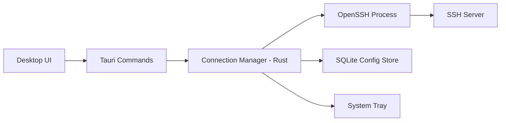

# Thiết kế app quản lý SSH tunnels — tnls

Ngày: 2026-10-09. Trạng thái: đã duyệt, bắt đầu triển khai.

## 1. Vấn đề

Mỗi lần cần tunnel phải mở terminal gõ lệnh SSH thủ công, mỗi terminal session giữ 1 tunnel.
Cần app nhỏ nhẹ: lưu tunnel profiles, bật/tắt bằng UI, chạy nền không cần terminal.

## 2. Kiến trúc



## 3. Tech stack (đã chốt)

| Thành phần | Lựa chọn | Lý do |
|---|---|---|
| Desktop framework | Tauri 2 | Nhẹ, cross-platform, system tray |
| Frontend | React + TypeScript + Vite | CRUD + trạng thái tunnel |
| Backend | Rust + Tokio | Quản lý process, lifecycle |
| SSH engine (MVP) | OpenSSH có sẵn (`ssh`/`ssh.exe`) | Tương thích ssh config, agent, key, ProxyJump; ít code |
| Persistence | SQLite | Migration, history, nhiều profile |
| Logging | `tracing` | Log stdout/stderr, lỗi kết nối |
| Packaging/CI | Tauri bundler + GitHub Actions | Build Windows/macOS/Linux |

Không dùng thư viện SSH native (`russh`) ở MVP: phải tự xử lý host-key
verification, agent, key parsing, jump host, reconnect — scope lớn, rủi ro bảo mật.

## 4. Quyết định kiến trúc (bất biến trừ khi có lý do rõ ràng)

1. OpenSSH process, không phải SSH native, cho MVP.
2. Một supervisor Rust (`TunnelManager`) sở hữu mọi tunnel process.
3. Lưu typed config, KHÔNG lưu raw shell command.
4. Build SSH command bằng mảng args, KHÔNG qua shell (tránh injection, quoting).
5. Bind mặc định `127.0.0.1`, tránh expose tunnel ra mạng.
6. Luôn dùng `-N -T -o ExitOnForwardFailure=yes -o BatchMode=yes`.
7. Keepalive: `ServerAliveInterval` + `ServerAliveCountMax`.
8. Health check 2 lớp: process còn sống + TCP connect tới local bind.
9. Retry (backoff 1s/2s/5s/10s, tối đa 30s, 3–5 lần) CHỈ cho lỗi tạm thời
   (timeout, reset, server tạm unavailable). Không retry lỗi cấu hình
   (port conflict, bad key, host-key mismatch, permission denied).
10. Không lưu password plaintext, private key, passphrase. Không bypass `known_hosts`.
10b. Trước mỗi lần start (kể cả retry), kiểm tra `bind:local_port`: trước tiên với các
    tunnel tnls đang có ssh process (cùng port, bind trùng hoặc một bên là 0.0.0.0), sau đó
    với OS (try-bind; Windows dùng `netstat -ano` + `tasklist`, macOS/Linux dùng `lsof`/`ss`
    nếu có sẵn). Conflict thì không start, không retry, không đổi state; UI nêu tên tunnel
    hoặc process đang giữ port. Conflict lọt qua tới ssh (race) vẫn thành Failed với cùng
    thông báo. `-R` không mở listener local nên không bị kiểm tra.
11. Nút đóng window không tự thoát: app hỏi "Minimize to tray" hay "Quit" (có thể nhớ lựa chọn,
    đổi lại trong menu ⋯ → Close button). Tray icon mở lại window. Quit (từ dialog, tray hay
    lúc OS tắt app) luôn stop toàn bộ tunnel, không để process mồ côi.

## 5. MVP scope

CRUD profiles; local forwarding (`-L`); start/stop/restart; SQLite; system tray;
runtime status (Stopped/Starting/Running/Stopping/Failed/Degraded);
TCP health check; SSH config alias; logs; auto-start; graceful shutdown.

Ngoài MVP: dynamic SOCKS (`-D`), remote forwarding (`-R`), ProxyJump form,
retry policy UI, OS keychain, import/export, import `~/.ssh/config`,
native `russh` engine, multiplexing, SFTP, terminal, cloud sync, service mode.

## 6. Tunnel profile

```text
id, name, type (local|remote|dynamic),
ssh_host, ssh_port, ssh_user, identity_file,
local_bind_address (=127.0.0.1), local_port,
remote_host, remote_port,
jump_host / ssh_config_alias,
auto_start, keep_alive,
created_at, updated_at
```

Ví dụ command được generate (không lưu):

```bash
ssh -N -T \
  -o ExitOnForwardFailure=yes -o BatchMode=yes \
  -o ServerAliveInterval=30 -o ServerAliveCountMax=3 \
  -L 127.0.0.1:5433:postgres.internal:5432 \
  dev-bastion
```

## 7. Schema SQLite

```sql
CREATE TABLE tunnels (
    id TEXT PRIMARY KEY,
    name TEXT NOT NULL,
    mode TEXT NOT NULL CHECK (mode IN ('local','remote','dynamic')),
    ssh_target TEXT NOT NULL,
    bind_address TEXT NOT NULL DEFAULT '127.0.0.1',
    local_port INTEGER,
    remote_host TEXT,
    remote_port INTEGER,
    identity_file TEXT,
    auto_start INTEGER NOT NULL DEFAULT 0,
    keep_alive_interval INTEGER NOT NULL DEFAULT 30,
    created_at TEXT NOT NULL,
    updated_at TEXT NOT NULL
);
-- v2: proxy_jump TEXT
-- v3: max_retries INTEGER NOT NULL DEFAULT 5, retry_delay_secs INTEGER NOT NULL DEFAULT 1
-- v4: tags TEXT NOT NULL DEFAULT '[]'   -- JSON array of strings
```

### 6.1 Diagnostics (read-only)

`diagnose_tunnel` chạy 3 bước theo thứ tự, dừng ở bước fail đầu tiên. Không start/stop/
restart tunnel, không đổi state đã lưu. Mọi lệnh ssh đi qua `ssh::assemble_argv` (cùng
identity file, ProxyJump, BatchMode, keepalive với tunnel thật), kết quả exit qua
`ssh::classify_exit`.

| Bước | Cách làm | Pass khi |
|---|---|---|
| 1. SSH auth / reachability | `ssh -N -T -o ConnectTimeout=5 -o LogLevel=DEBUG2 …` (không forward) | dòng `Authenticated to …` của kết nối chính |
| 2. Local forward | kiểm tra port như lúc start (tunnel khác + OS); nếu chính tunnel này đang chạy thì dial port | port trống, hoặc đang do chính tunnel giữ và nhận kết nối |
| 3. Destination | `ssh -T -W host:port …` (stdio, không mở listener) | dòng `channel N: open confirm` sau dòng auth |

Bước 3 phân biệt timeout / connection refused / DNS / no route / bị server cấm forward từ
thông điệp `open failed:` của server. `-D` bỏ qua bước 3 (không có đích cố định); `-R` bỏ
qua bước 2 (listener ở phía server) và dial đích từ máy này. Khi đi qua ProxyJump
(`-J` hoặc từ `~/.ssh/config`, xác định bằng `ssh -G`), chỉ dòng `Authenticated to … (via
proxy)` mới là kết nối chính; dòng auth/channel của hop trung gian bị bỏ qua. Mỗi bước
ghi một dòng log `tnls: diagnose N/3 …` với level từ backend (PASS = INFO, FAIL = ERROR,
SKIP = DEBUG), và gửi event `tunnel://diagnose-stage` để UI hiện từng bước khi xong.

Giới hạn: passphrase lưu trong keychain hiện chưa được đưa cho ssh (cả tunnel lẫn
diagnostics, vì `BatchMode=yes`); key có passphrase cần ssh-agent.

### 7.1 Tags (v4)

Chọn **nhiều tag cho mỗi tunnel**, lưu dạng mảng JSON trong cột `tags` của bảng
`tunnels`, thay vì bảng `tags` + bảng nối:

- Một tunnel thường thuộc nhiều nhóm cùng lúc (`homelab` + `9router`), nên "một group
  mỗi tunnel" sẽ sớm không đủ.
- Số tunnel nhỏ (hàng chục), lọc theo tag làm ở frontend trên danh sách đã load; không
  cần index hay JOIN. Bảng nối chỉ thêm migration và đồng bộ mà không đổi được gì.
- Tag tồn tại khi còn ít nhất một tunnel dùng nó; không có danh sách tag riêng để quản lý.

Quy tắc (`tunnel::normalize_tags`, kiểm tra trong `validate`): trim, bỏ chuỗi rỗng, trùng
không phân biệt hoa thường thì giữ cách viết đầu tiên, tối đa 16 tag, mỗi tag 1–32 ký tự.
Tunnel không có tag hiện là **Ungrouped**. Migration v4 thêm cột với mặc định `'[]'`, nên
mọi profile cũ load được và rơi vào Ungrouped.

Import/Export:

| Đường | Tags |
|---|---|
| Export JSON ("Copy all as JSON") | Có, trường `tags` |
| Import JSON | Có; file export cũ không có `tags` vẫn import được (coi như không tag) |
| Duplicate | Giữ nguyên tags |
| Import `~/.ssh/config` | Không: định dạng ssh_config không có khái niệm tag, tunnel import vào Ungrouped |

Phạm vi: chỉ nhóm tunnel. Không có folder cho host, không chia sẻ theo user/role, không sync.

## 8. API Tauri (frontend ↔ Rust)

Commands: `list_tunnels, create_tunnel, update_tunnel, delete_tunnel,`
`start_tunnel, stop_tunnel, restart_tunnel, get_tunnel_logs, get_runtime_status`.
Events Rust → frontend: `tunnel://state-changed, tunnel://log,`
`tunnel://process-exited, tunnel://health-changed`.
Frontend không đọc process, không build SSH command.

## 9. Cấu trúc source mục tiêu

```text
src/                      # React: TunnelList, TunnelForm, StatusBadge, LogDrawer, lib/api, types
src-tauri/src/
  main.rs
  commands/tunnel_commands.rs
  tunnel/{config, manager, process, health, state, errors}.rs
  persistence/sqlite.rs
  tray.rs  logging.rs
```

## 10. Roadmap

- Phase 0: PoC — 1 tunnel hardcoded, start/stop, xem stderr.
- Phase 1: MVP (mục 5).
- Phase 2: SOCKS, remote forward, ProxyJump form, keychain, import/export.
- Phase 3: `russh` tùy chọn, service mode, backup mã hóa.
